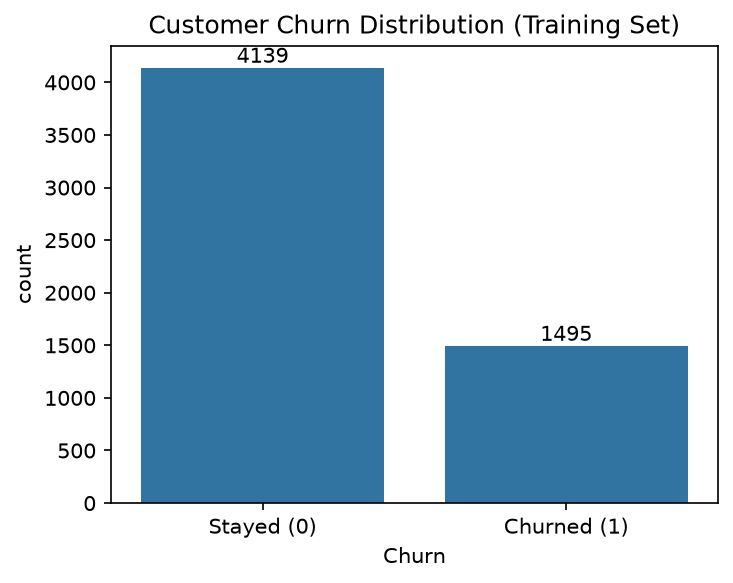
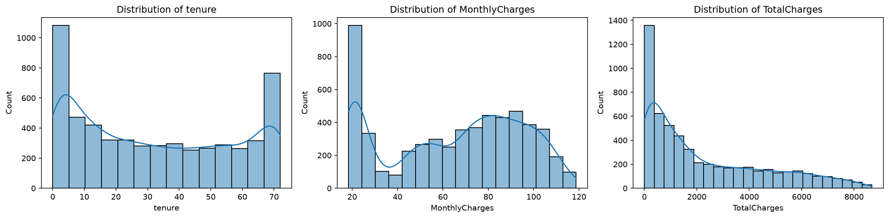
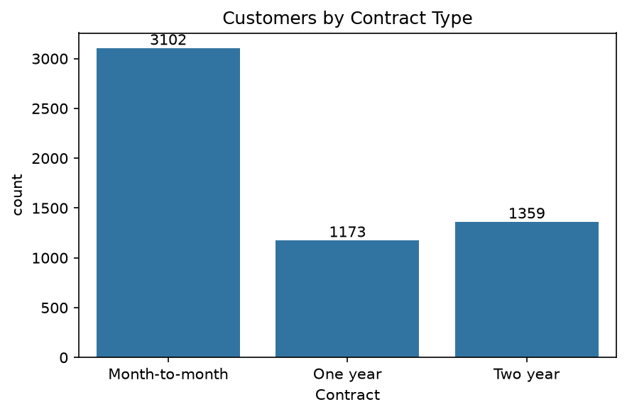
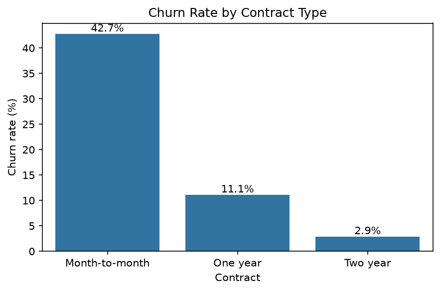
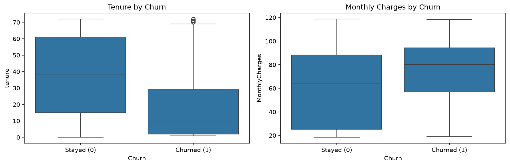
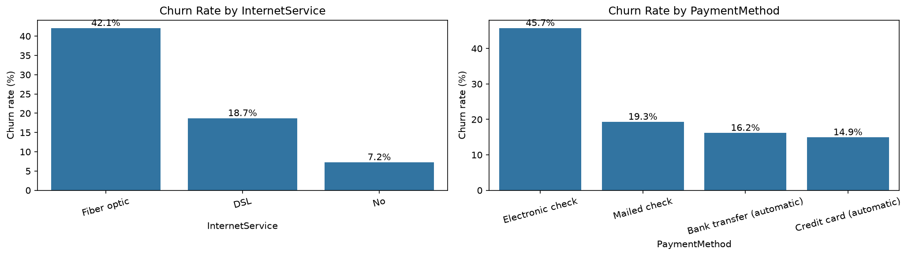
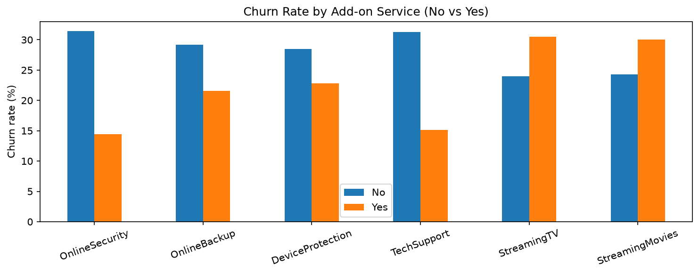
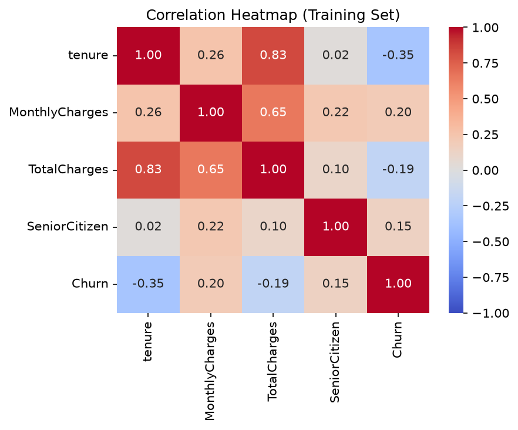
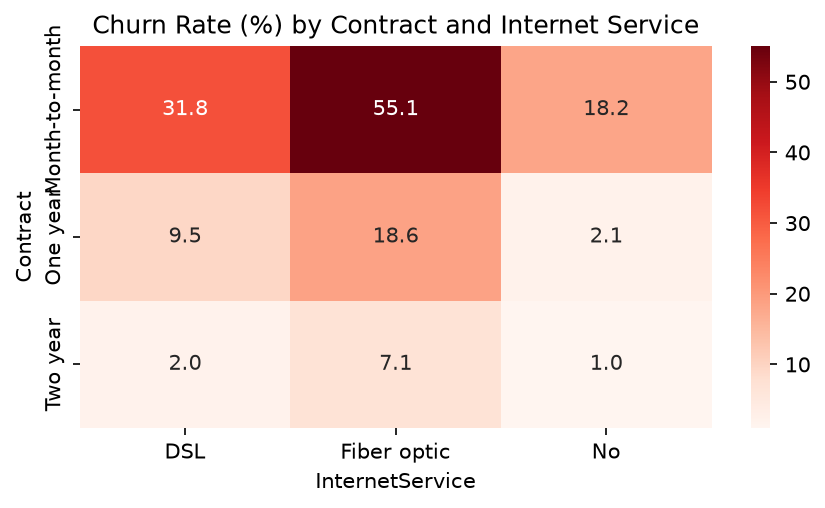

# EDA Report: Telecom Customer Churn

All analysis below uses the **training set only** (5,634 customers) so that no test-set information shapes modelling decisions. Patterns are associations in the data, not proven causes.

## 1. Target distribution

- **Why:** to know the baseline churn rate.
- **Shows:** 4,139 customers stayed and 1,495 churned (26.5%).
- **Insight:** about 1 in 4 customers leaves, a serious revenue problem for a subscription business.
- **Decision:** judge models by recall, precision, F1 and ROC-AUC, not accuracy; a model that always predicts "stayed" is about 73% accurate and catches no churners.

## 2. Numeric distributions

- **Why:** to see how tenure, monthly charges and total charges are spread.
- **Shows:** tenure is U-shaped, with a large group in the first few months (roughly 1,080 customers in the first bar, read from the chart) and another near 70 months (roughly 770). Monthly charges have a spike near 20 and a broad hump from about 60 to 100. Total charges are strongly right-skewed.
- **Insight:** the base is split between many new customers and a loyal long-term group. The spike near 20 in monthly charges probably reflects cheap basic plans; this is a hypothesis, not proven by the chart.
- **Decision:** compare churn for new vs long-term customers; the skew in total charges matters mainly for linear models.

## 3. Customers by contract type

- **Why:** to see how customers are spread across contract commitments.
- **Shows:** 3,102 month-to-month (55%), 1,173 one-year (21%), 1,359 two-year (24%).
- **Insight:** more than half the base can leave at any time with no commitment.
- **Decision:** contract type is a candidate churn driver, tested in the next chart.

## 4. Churn rate by contract type

- **Why:** the previous chart shows how many customers are on each contract; this one shows who leaves.
- **Shows:** month-to-month 42.8%, one-year 11.1%, two-year 2.9%; month-to-month churn is about 15 times the two-year rate.
- **Insight:** most lost revenue comes from the largest group, month-to-month customers.
- **Decision:** target retention at month-to-month customers, for example with incentives to move to a longer contract.

## 5. Tenure and monthly charges by churn

- **Why:** to compare churners with stayers on how long they stayed and how much they pay.
- **Shows (medians read from the chart):** churners have a median tenure of about 10 months vs about 38 for stayers, and a median monthly charge of about 80 vs about 65.
- **Insight:** customers tend to leave early, and those who leave pay more per month. Price may play a role; the chart cannot prove it.
- **Decision:** focus onboarding and first-year support on new customers, and review the value offered at higher price points.

## 6. Churn by internet service and payment method

- **Why:** to test whether service type or payment method is linked to churn.
- **Shows:** fiber optic 42.1%, DSL 18.7%, no internet 7.2%; electronic check 45.7%, mailed check 19.3%, bank transfer (automatic) 16.2%, credit card (automatic) 14.9%.
- **Insight:** the premium fiber product has a retention problem, and electronic check users churn at about three times the rate of automatic payers (which may reflect more settled customers, not a payment effect).
- **Decision:** investigate fiber pricing and service quality; encourage automatic payment.

## 7. Churn by add-on service

| Add-on | Churn without (%) | Churn with (%) |
|---|---|---|
| OnlineSecurity | 31.4 | 14.4 |
| OnlineBackup | 29.2 | 21.6 |
| DeviceProtection | 28.5 | 22.8 |
| TechSupport | 31.2 | 15.2 |
| StreamingTV | 24.0 | 30.5 |
| StreamingMovies | 24.3 | 30.1 |

- **Why:** to see whether customers with support and protection add-ons stay longer.
- **Insight:** Online Security and Tech Support show the largest gaps; streaming customers churn more.
- **Caution:** the "without" group includes customers with no internet at all (7.2% churn), because "No internet service" was merged into "No" during cleaning. The streaming result is probably tied to fiber, but that is a hypothesis.
- **Decision:** consider trials of security and support add-ons for at-risk customers.

## 8. Correlation heatmap

- **Why:** to see how numeric columns relate to churn and to each other.
- **Shows:** correlation with churn: tenure -0.35, MonthlyCharges +0.20, TotalCharges -0.19, SeniorCitizen +0.15. Between features: tenure and TotalCharges 0.83, MonthlyCharges and TotalCharges 0.65.
- **Insight:** churn is linked to being newer, paying more and being a senior citizen, but none of these correlations is strong; churn depends on combinations.
- **Decision:** TotalCharges overlaps heavily with the other two charge columns, so watch multicollinearity in linear models. Correlation measures only straight-line relationships.

## 9. Contract and internet service together

| Contract | DSL | Fiber optic | No internet |
|---|---|---|---|
| Month-to-month | 31.8% | 55.1% | 18.2% |
| One year | 9.5% | 18.6% | 2.1% |
| Two year | 2.0% | 7.1% | 1.0% |

- **Why:** to check whether contract type still matters within each internet service.
- **Insight:** both effects hold and stack; the highest-risk group is fiber optic customers on month-to-month contracts at 55.1%.
- **Caution:** group sizes were not printed, so cells with few customers are less reliable.
- **Decision:** prioritise fiber month-to-month customers for retention offers.

## 10. Engineered features (training set)

| Feature | Evidence |
|---|---|
| tenure_group | churn 47.3% (0-12 months), 28.6%, 20.2%, 9.9% (49-72 months) |
| num_addons | 45.8% with one add-on, falling to 4.7% with six; zero add-ons (20.9%) mixes in customers with no internet |
| has_internet | 31.8% with internet vs 7.2% without |
| auto_pay | 15.5% with automatic payment vs 35.0% without |
| has_support | 17.1% with Online Security or Tech Support vs 33.5% with neither |

`gender` was dropped: churn was 26.6% (female) vs 26.4% (male), so it carried no signal.

## Summary of findings

| # | Finding | Evidence |
|---|---|---|
| 1 | About 1 in 4 customers churns | 26.5% |
| 2 | Month-to-month contracts churn most | 42.8% vs 11.1% vs 2.9% |
| 3 | Churners are newer customers | tenure correlation -0.35; 47.3% churn in months 0-12 |
| 4 | Churners pay more per month | median about 80 vs about 65 |
| 5 | Fiber optic customers churn most | 42.1% vs 18.7% (DSL) |
| 6 | Electronic check payers churn most | 45.7% vs 14.9-19.3% |
| 7 | Security and support add-ons go with lower churn | 14.4% vs 31.4%; 15.2% vs 31.2% |
| 8 | Highest-risk segment: fiber + month-to-month | 55.1% |
| 9 | TotalCharges overlaps other numeric features | correlation 0.83 with tenure |
