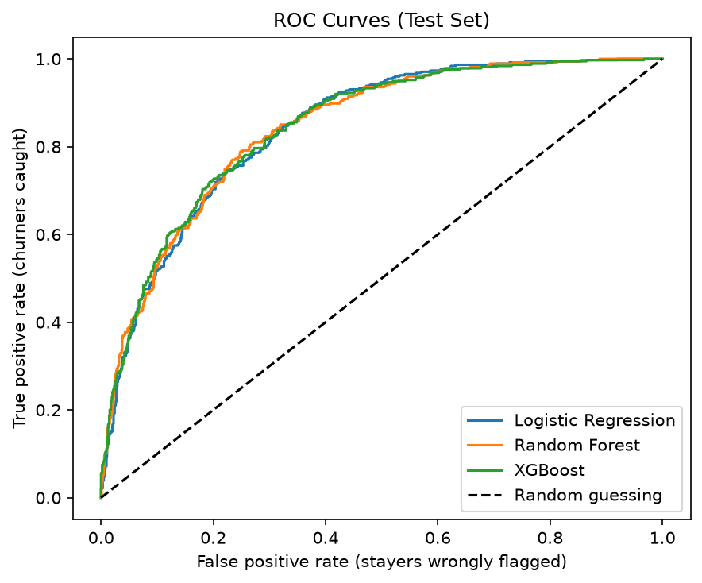
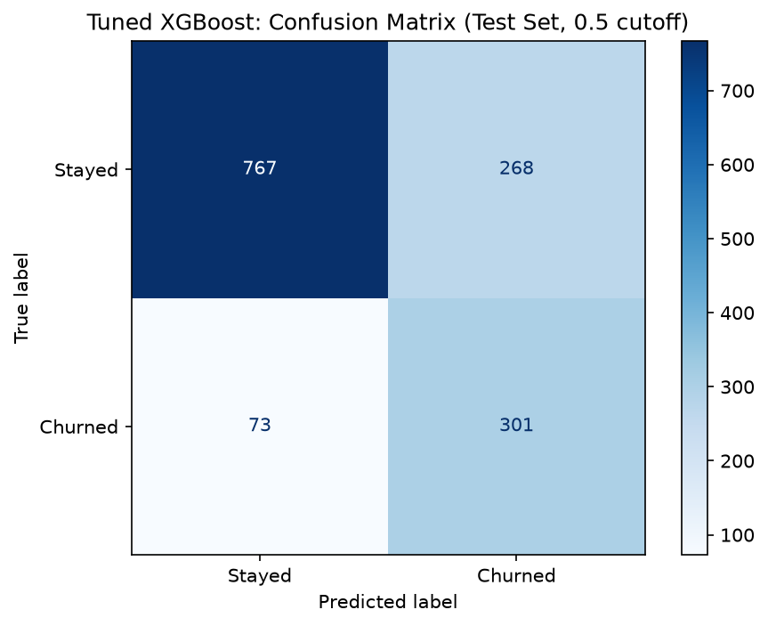
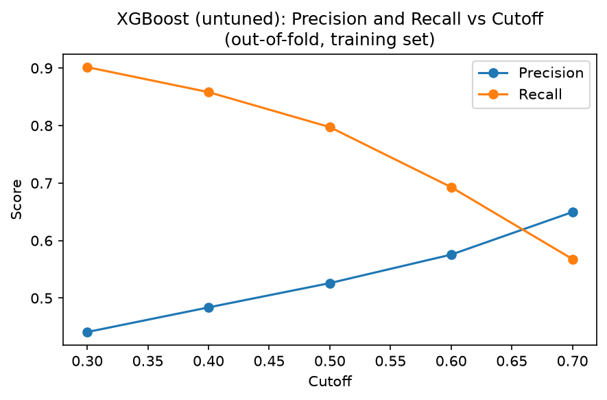

# Model Evaluation Report: Telecom Churn Models

## 1. Evaluation setup
- **Data:** 7,043 customers; 80/20 stratified split (5,634 train, 1,409 test with 374 churners); churn rate 26.5% in all sets.
- **Preprocessing:** StandardScaler and one-hot encoding inside a scikit-learn Pipeline, fitted on training data only (refit inside every cross-validation fold).
- **Imbalance:** handled with class weights (`class_weight='balanced'`; `scale_pos_weight` 2.77 for XGBoost).
- **Metrics:** accuracy is shown but not used to choose models, because a model that always predicts "stayed" scores 0.735. Precision, recall, F1 and ROC-AUC drive the comparison. Recall matters because a missed churner is the costly mistake; precision shows how much outreach is wasted.
- **Library versions:** scikit-learn 1.9.1, xgboost 3.4.2 (see requirements.txt). Results from a different library version can differ slightly.

## 2. Test-set results, default 0.5 cutoff (untuned models)

| Model | Accuracy | Precision | Recall | F1 | ROC-AUC |
|---|---|---|---|---|---|
| Dummy (always stayed) | 0.735 | 0.000 | 0.000 | 0.000 | 0.500 |
| Logistic Regression | 0.738 | 0.504 | 0.786 | 0.614 | 0.843 |
| Random Forest | 0.761 | 0.534 | 0.775 | 0.632 | 0.844 |
| XGBoost | 0.747 | 0.515 | 0.786 | 0.622 | 0.845 |

The dummy model looks acceptable on accuracy yet catches no churners, which is why accuracy is not used. The three real models are within 0.002 ROC-AUC of each other.

The three ROC curves almost overlap, so no model ranks customers by churn risk better than the others at any cutoff.

## 3. Cross-validation (training set, 5 folds, mean ± standard deviation)

| Model | ROC-AUC | Recall | Precision | F1 |
|---|---|---|---|---|
| Logistic Regression | 0.846 ± 0.012 | 0.794 ± 0.042 | 0.516 ± 0.018 | 0.625 ± 0.024 |
| Random Forest | 0.846 ± 0.011 | 0.767 ± 0.022 | 0.542 ± 0.016 | 0.635 ± 0.016 |
| XGBoost | 0.846 ± 0.011 | 0.797 ± 0.025 | 0.526 ± 0.014 | 0.634 ± 0.016 |

The differences between models are within the fold-to-fold spread, so the three models are **statistically tied** on every metric. A single test split cannot separate them.

## 4. Hyperparameter tuning

| Model | Best parameters | CV ROC-AUC before | CV ROC-AUC after |
|---|---|---|---|
| Logistic Regression | C = 10, penalty = l2 | 0.846 | 0.846 |
| XGBoost | n_estimators 200, max_depth 5, learning_rate 0.01, subsample 0.7, colsample_bytree 1.0, min_child_weight 1 | 0.846 | 0.848 |

GridSearchCV (Logistic Regression) and RandomizedSearchCV with 20 candidates (XGBoost) were run on the training set only, optimizing ROC-AUC. The XGBoost gain of 0.002 is far smaller than the fold-to-fold spread of about 0.012, so **tuning made no meaningful difference**. A search's best score is also slightly optimistic, because the winner is picked from many candidates on the same folds. Logistic Regression's best C was the largest value in the grid; the score did not change, so the grid was not extended. Tuned XGBoost's `max_depth` and `learning_rate` sit at the edges of the searched ranges.

## 5. Final test-set check (tuned models)

| Model | Accuracy | Precision | Recall | F1 | ROC-AUC |
|---|---|---|---|---|---|
| Logistic Regression (tuned) | 0.740 | 0.507 | 0.791 | 0.618 | 0.842 |
| XGBoost (tuned) | 0.758 | 0.529 | 0.805 | 0.638 | 0.846 |

Tuned XGBoost: 767 true negatives, 268 false positives, 73 false negatives, 301 true positives. It caught 301 of 374 churners (80.5%), missed 73, and flagged 569 customers, of whom 52.9% were real churn risks. The test set was used once for this check, after all tuning decisions were made. With only 374 churners in the test set, small differences between the tuned models (for example 14 more churners caught by XGBoost) are within what chance could produce.

## 6. Choosing the cutoff

All results above use the default 0.5 cutoff. The table shows precision, recall, F1 and the share of customers flagged at other cutoffs, from out-of-fold predictions on the training set (untuned models), so the test set played no part.

| Model | Cutoff | Precision | Recall | F1 | % flagged |
|---|---|---|---|---|---|
| Logistic Regression | 0.3 | 0.426 | 0.922 | 0.582 | 57.5 |
| Logistic Regression | 0.4 | 0.469 | 0.864 | 0.608 | 48.8 |
| Logistic Regression | 0.5 | 0.516 | 0.794 | 0.626 | 40.8 |
| Logistic Regression | 0.6 | 0.574 | 0.712 | 0.635 | 32.9 |
| Logistic Regression | 0.7 | 0.641 | 0.579 | 0.608 | 24.0 |
| Random Forest | 0.3 | 0.441 | 0.901 | 0.592 | 54.2 |
| Random Forest | 0.4 | 0.492 | 0.841 | 0.621 | 45.4 |
| Random Forest | 0.5 | 0.542 | 0.767 | 0.635 | 37.6 |
| Random Forest | 0.6 | 0.595 | 0.656 | 0.624 | 29.3 |
| Random Forest | 0.7 | 0.659 | 0.513 | 0.577 | 20.7 |
| XGBoost | 0.3 | 0.441 | 0.902 | 0.592 | 54.3 |
| XGBoost | 0.4 | 0.484 | 0.858 | 0.619 | 47.1 |
| XGBoost | 0.5 | 0.526 | 0.797 | 0.634 | 40.2 |
| XGBoost | 0.6 | 0.576 | 0.693 | 0.629 | 31.9 |
| XGBoost | 0.7 | 0.650 | 0.568 | 0.606 | 23.2 |

- Raising the cutoff flags fewer customers: precision rises and recall falls.
- At a similar share of customers flagged, the three models perform almost the same. Differences at the default cutoff mostly reflect where each model's 0.5 falls, not a real quality gap.
- F1 stays within about 0.03 across cutoffs 0.4 to 0.6 for each model, so F1 cannot choose the cutoff.
- Scores are not calibrated probabilities: class weights shift them upward, so use them to rank customers, not as percentages.
- **The right cutoff is a business decision** that depends on how many customers the retention team can contact and on how the cost of an offer compares with the revenue from a saved customer. Neither is in this dataset, so no cutoff is recommended here.

## 7. Final model selection
**Final model: tuned XGBoost. Benchmark: tuned Logistic Regression.**

*Technical view.* The models are tied on ROC-AUC, recall, precision and F1. Tuned XGBoost has the highest tuned CV ROC-AUC (0.848 vs 0.846, within noise), works with SHAP's fast tree explainer, and is the common industry choice. Random Forest showed no advantage and was dropped. LightGBM was not used because it would add little beyond XGBoost on a dataset of this size.

*Business view.* Because the models perform alike, the choice affects explainability and workflow, not detection. Logistic Regression is the easiest to explain to non-technical staff, and choosing it would be equally defensible. XGBoost's detection of churners (recall 0.805 on the test set) is similar.

## 8. Limitations of this evaluation
- One train-test split of 1,409 customers (374 churners) gives noisy test estimates.
- Cross-validation uses 5 folds, so the ± spreads are rough.
- Public sample data with no time dimension; no out-of-time validation.
- Retention costs and offer effectiveness are unknown, so business value was not estimated.
- Fairness was checked for SeniorCitizen only (see the Model Card).
